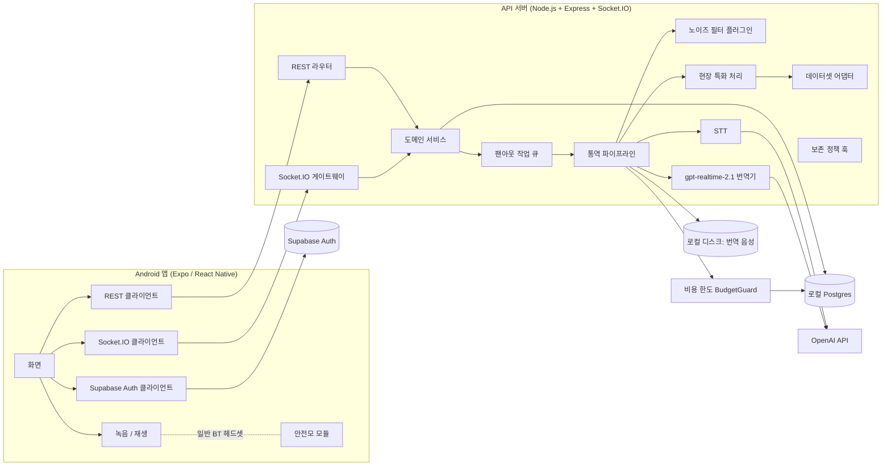
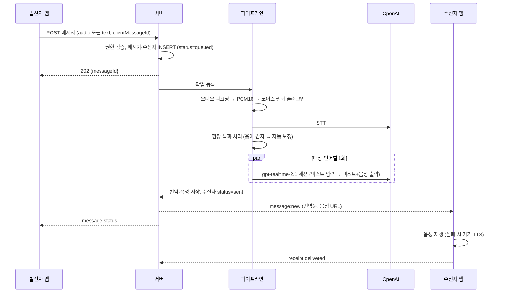

# 시스템 아키텍처

## 1. 구성 요소



| 구성 요소 | 기술 | 책임 |
|---|---|---|
| 모바일 앱 | Expo(dev build) + React Native + TS, expo-router, TanStack Query, Zustand, expo-audio | 화면, 인증 세션, 녹음·재생, 실시간 수신 |
| 인증 | Supabase Auth | 회원가입, 로그인, 토큰 발급·갱신, 비밀번호 재설정 메일 |
| API 서버 | Express + TS | 권한 검증, 현장·멤버십·대화·지시 관리, 파이프라인 실행 |
| 실시간 | Socket.IO | 메시지·상태 푸시, 수신 확인, 연결 상태 |
| DB | 로컬 Postgres (`embedded-postgres`, Docker 불필요) + Prisma 7 | 영구 데이터 |
| 음성 저장 | 서버 로컬 디스크 (`server/storage/audio`) | 번역 음성 파일, 다시 듣기·재접속 재생용 |
| 통역 엔진 | `server/src/engine` | STT, 현장 특화 처리, `gpt-realtime-2.1` 번역, 비용 한도 |

Redis·메시지 큐는 MVP에서 도입하지 않는다. 단일 서버 프로세스 안의 동시성 제한 큐로 처리하고, 서버 재시작 시 DB 상태로 복구한다. 서버를 여러 대로 늘릴 때 `@socket.io/redis-adapter`와 별도 작업 큐를 도입한다.

## 2. 폴더 구성

```
SYNCREW/
├─ frontend/                   # Expo 앱 (신규 UI). src/app = 화면(expo-router)
├─ server/
│  ├─ src/shared/              # 서버·앱 공유 계약 (언어 코드, 오류 코드, 응답 타입). 외부 패키지 import 금지
│  ├─ src/engine/              # 통역 엔진: 현장 특화 처리, 데이터셋 어댑터, 전처리, STT·번역 인터페이스, 비용 한도
│  ├─ src/plugins/             # 다른 개발자 연결 지점: 노이즈 필터, 데이터셋, 보존 정책
│  ├─ data/legacy-workplace/   # 기존 저장소 데이터셋 원본 복사 (샘플 어댑터 대상)
│  └─ prisma/                  # 스키마, 마이그레이션
└─ docs/
```

- 앱은 `@shared/*` 경로로 `server/src/shared`를 직접 import한다 (tsconfig paths + Metro watchFolders).
- 공유 파일은 외부 패키지를 쓰지 않는 순수 TS로 유지한다. 런타임 검증용 zod 스키마는 서버에 둔다.

## 3. 역할 분담: REST와 Socket.IO

- **REST**: 상태를 바꾸는 모든 명령(메시지 전송, 가입, 승인, 확인)과 조회. 멱등 키(`clientMessageId`)로 재시도 안전성 확보. 음성 업로드도 REST multipart.
- **Socket.IO**: 서버 → 클라이언트 푸시(새 메시지, 상태 변화, 멤버십 변화)와 클라이언트의 수신 확인(`receipt:delivered`).
- 소켓 이벤트가 유실돼도 클라이언트는 재접속 시 REST로 동기화하므로 데이터는 DB가 기준이다.

## 4. 통역 파이프라인

> Phase 5: 1:1 통역 통화·관리자 실시간 일괄 지시는 이 파이프라인을 "핸즈프리 발화 단위"로 사용한다 (앱이 말 끝을 감지해 문장마다 자동 전송, 받는 쪽 자동 재생). 세션 관리·이어폰 처리: [live-interpretation.md](live-interpretation.md)

### 4-1. 흐름



### 4-2. 단계별 설계

| 단계 | 구현 | 설정 |
|---|---|---|
| 1. 입력 | 텍스트 또는 음성(m4a/aac, 최대 30초, 2MB) | |
| 2. 디코딩 | `ffmpeg-static`으로 PCM16 mono 16kHz로 변환. 업로드 파일을 디스크에 저장한 뒤 **파일 경로로** 읽는다 (휴대폰 m4a는 moov 색인이 파일 끝에 있어 파이프 입력 불가) | `STORAGE_DIR` |
| 3. 노이즈 필터 | `AudioPreprocessor` 플러그인 호출 (5절) | `AUDIO_PREPROCESSOR` |
| 4. STT | OpenAI `/v1/audio/transcriptions` (WAV 업로드, `language`=발신자 언어, 현장 용어 프롬프트, `response_format=json`) | `STT_MODEL` (기본 `gpt-4o-mini-transcribe`) |
| 5. 현장 특화 처리 | 용어 감지 → 자동 보정 → 컨텍스트 생성 (6절) | `DATASET_ADAPTER` |
| 6. 번역 | `gpt-realtime-2.1` (4-3) | `TRANSLATION_MODEL=gpt-realtime-2.1` |
| 7. 음성 출력 | Realtime 음성 출력(PCM16 24kHz)을 WAV로 감싸 로컬 디스크에 저장 | `TRANSLATION_AUDIO=on` |
| 8. 전달 | 언어별 번역이 끝날 때마다 그 언어 수신자에게 `message:new` | |

구현: `server/src/messaging/pipeline.ts`(작업 큐·재시도·복구), `engine/stt/openAiStt.ts`, `engine/translation/realtimeTranslator.ts`, `engine/audio/codec.ts`. 테스트·개발용 `engine/fake.ts`(`ENGINE=fake`면 키 없이 "[vi] 원문" 형식으로 동작).

- 발신자와 수신자 언어가 같으면 번역을 생략하고 원문을 그대로 전달한다.
- 그룹 대화와 일괄 지시는 **대상 언어별로 한 번만** 번역하고 결과를 해당 언어의 모든 수신자에게 재사용한다.
- 동시 Realtime 세션 수는 `TRANSLATION_CONCURRENCY`(기본 4)로 제한한다.
- STT·번역은 1회 + 재시도 2회. 비용 한도 초과는 재시도하지 않는다. 같은 메시지 작업은 순서대로 실행하고, 번역 행은 조건부 UPDATE(`pending|failed → processing`)로 선점해 중복 처리를 막는다.
- 단계별 시간은 `messages.timings`(decode·preprocess·stt·domain)와 `message_translations.timings`(translate·save), `latency_ms`에 기록한다.

### 4-3. gpt-realtime-2.1 사용 방식

- 서버가 OpenAI Realtime API에 **WebSocket으로 서버 간 연결**한다. API 키는 서버에만 존재한다.
- 번역 작업 1건(메시지 1개 × 대상 언어 1개)마다 세션을 열고 응답 완료 후 닫는다.
- 프로토콜 (2026-10-12 OpenAI 공식 문서 확인, GA 인터페이스)
  - 연결: `wss://api.openai.com/v1/realtime?model=gpt-realtime-2.1`, 헤더는 `Authorization: Bearer`만 (`OpenAI-Beta` 헤더 없음)
  - `session.update`: `session.type="realtime"`, `instructions`, `output_modalities`, `audio.input.turn_detection=null`, `audio.output.format={type:"audio/pcm", rate:24000}`, `audio.output.voice`(`TRANSLATION_VOICE`, 기본 `marin`), `reasoning.effort`(`TRANSLATION_REASONING`, 기본 `low`)
  - 입력: `conversation.item.create`(role user, `input_text`) → `response.create`
  - 수신: `response.output_audio.delta`(base64 PCM16 24kHz), `response.output_audio_transcript.delta/done`, (텍스트만이면 `response.output_text.*`), `response.done`(상태·`usage`), `error`
- `output_modalities`는 `["audio"]`(음성 + 전사) 또는 `["text"]` 중 하나만 가능하다. 음성을 켜면 `["audio"]`로 요청하고 전사를 번역문으로 쓴다 (`TRANSLATION_AUDIO=off`면 `["text"]`).
- `instructions`: 역할(현장 통역사), 원문·대상 언어, 도메인 규칙(기존 PoC 프롬프트 문구 재사용), 현장 특화 처리에서 만든 용어 컨텍스트·검증 문장, "번역문만 말할 것"
- 입력 텍스트는 현장 특화 처리로 보정된 원문
- 타임아웃 15초. 실패 시 최대 2회 재시도 후 해당 언어를 `failed`로 기록
- 모델: 2026-10-12 사용자 결정으로 `gpt-realtime-2` → `gpt-realtime-2.1` (같은 가격, 프로토콜 동일). `TRANSLATION_MODEL`로 되돌릴 수 있고 두 모델 모두 단가표에 있다.

참고: Realtime 세션 연결 비용(수백 ms)이 지연에 포함된다. 측정 후 필요하면 언어별 세션 상시 유지를 추후 도입한다. Realtime 음성 출력 비용은 텍스트 모델보다 높으므로 사용량을 기록한다.

## 5. 노이즈 필터 플러그인 (다른 개발자 제공 예정)

```ts
// server/src/engine/audio/audioPreprocessor.ts
export type PcmAudio = {
  data: Int16Array;      // PCM16 mono
  sampleRate: number;    // 기본 16000
};

export interface AudioPreprocessor {
  readonly name: string;
  process(audio: PcmAudio, ctx: { siteId: string; userId: string; lang: Lang }): Promise<PcmAudio>;
}
```

- 서버 등록 위치: `server/src/plugins/audioPreprocessor.ts`의 `PREPROCESSORS`에 이름과 함께 등록하고 `.env`의 `AUDIO_PREPROCESSOR`에 그 이름을 적는다.
- 기본 구현: `PassthroughPreprocessor` (입력을 그대로 반환).
- 실패 처리: 예외, 3초 초과, 잘못된 출력이면 원본 오디오로 진행하고 경고 로그를 남긴다 (`runPreprocessorSafely`). 통역은 중단하지 않는다.
- 단말에서 실행해야 하는 경우를 위해 앱에도 같은 성격의 훅을 둔다: `frontend/src/audio/preprocess.ts`의 `preprocessRecording(fileUri): Promise<fileUri>` (기본: 그대로 반환).

## 6. 현장 특화 처리 (로직 구현, 데이터 교체 가능)

### 6-1. 데이터셋 어댑터

```ts
export type LexiconEntry = {
  id: string;
  lang: Lang;                          // 원어 (기본 ko)
  canonical: string;                   // 표준 표현
  variants: string[];                  // 은어·축약·발음 변형
  asrCorrections: string[];            // STT가 잘못 인식하는 형태
  translations: Partial<Record<Lang, string>>;
  meaning?: string;
  rule?: string;                       // 번역 규칙 (예: 음차 금지)
};

export type PhraseEntry = {
  id: string;
  lang: Lang;
  text: string;
  translations: Partial<Record<Lang, string>>;
};

export interface DatasetAdapter {
  readonly name: string;
  load(): Promise<{ version: string; lexicon: LexiconEntry[]; phrases: PhraseEntry[] }>;
}
```

- 기본 어댑터 `LegacyWorkplaceAdapter`: 기존 저장소 JSON(용어 팩, 은어 팩, vi-priority)을 **원본 형식 그대로** 읽어 위 형식으로 변환한다.
- 새 데이터셋은 어댑터를 하나 추가하거나, 위 형식의 JSON을 그대로 읽는 `NormalizedJsonAdapter`를 사용한다.
- 서버 시작 시 로드해 메모리 색인을 만든다. 재시작 없이 교체하는 기능은 추후.

### 6-2. 처리 단계

1. **정규화**: 공백·문장부호 정리, 소문자화(라틴·키릴 문자).
2. **용어 감지**: 원어의 `canonical`, `variants`, `asrCorrections`, 그리고 원어가 ko가 아닌 경우 `translations[원어]`를 대상으로 최장 일치 우선 검색 (Aho-Corasick 또는 정렬된 사전 순회).
3. **자동 보정**: 감지된 변형·오인식 표현을 `canonical`로 치환한 **보정 원문**을 만든다. 원본 STT 텍스트는 별도 보존한다.
4. **컨텍스트 생성**: 감지된 용어의 대상 언어 번역, 의미, 규칙과, 보정 원문과 일치하는 `PhraseEntry`의 대상 언어 번역(있으면 우선 사용 지시)을 묶어 번역기 `instructions`에 넣는다.
5. **결과 기록**: `glossaryHits`(용어 id 목록)와 보정 여부를 메시지에 저장한다.

세부 규칙 (구현: `server/src/engine/domain/domainProcessor.ts`)
- ko·zh는 공백을 무시하고 비교하고, 그 외 언어는 단어 경계를 지킨다.
- 2글자 미만 표현은 오탐 방지를 위해 감지하지 않는다.
- 같은 표현이 어떤 용어의 표준 표현이면서 다른 용어의 변형이면 표준 표현을 우선한다.
- 표준 표현으로 시작하는 변형(예: "오야지 하세요")은 활용형으로 보고 바꾸지 않는다.

대상 언어 번역 값이 없는 용어(예: 현재 데이터의 zh, uz, ru)는 의미와 규칙만 전달한다.

## 7. 데이터 보존 정책 훅 (다른 개발자 제공 예정)

```ts
export interface RetentionPolicy {
  readonly name: string;
  run(ctx: { now: Date; db: PrismaClient; logger: Logger }): Promise<{ deleted: Record<string, number> }>;
}
```

- 등록 위치: `server/src/plugins/retentionPolicy.ts`의 `POLICIES`, `.env`의 `RETENTION_POLICY`.
- 기본 구현: `NoopRetentionPolicy` (아무것도 삭제하지 않음).
- 실행: 서버 내부 스케줄러가 매일 `RETENTION_RUN_AT`(기본 03:00, 서버 로컬 시각)에 호출.
- 입력 음성 원본은 기본적으로 저장하지 않는다 (`STORE_INPUT_AUDIO=false`). 번역 음성은 로컬 디스크에 저장한다.

## 8. 블루투스 헤드셋 (안전모 모듈)

- 모듈은 일반 블루투스 헤드셋으로 취급한다. 별도 SDK 없음.
- 재생: OS가 연결된 헤드셋으로 자동 출력.
- 녹음: Android에서 블루투스 마이크 입력은 통화용 경로(SCO) 전환이 필요할 수 있다. Phase 4에서 실기기로 확인하고, 기본 동작으로 헤드셋 마이크가 잡히지 않으면 Expo config plugin으로 Android `AudioManager.setCommunicationDevice` 호출을 추가한다.

## 9. OpenAI 비용 한도

- `BudgetGuard` (`server/src/engine/budget/budgetGuard.ts`)가 모든 OpenAI 호출을 감싼다.
  1. 호출 전 `reserve(예상 비용)`: 이번 기간 사용액 + 진행 중 예약 + 예상 비용이 한도를 넘으면 `BudgetExceededError`로 거부
  2. 호출 후 `commit(실제 usage)`: 토큰 사용량과 비용을 `openai_usage` 테이블에 기록
  3. 호출 실패 시 `release`
- 한도: `OPENAI_BUDGET_USD=5`, 기간: `OPENAI_BUDGET_PERIOD=month`(매월 1일 UTC 초기화) 또는 `total`(누적).
- 단가: `gpt-realtime-2.1`(= `gpt-realtime-2`)은 OpenAI 모델 페이지 기준(텍스트 입력 $4 / 출력 $24, 음성 입력 $32 / 출력 $64, 캐시 입력 $0.4, 1M 토큰당).
  `gpt-4o-mini-transcribe`는 음성 입력 $1.25 / 출력 $5 (2026-10-12 가격 페이지). 텍스트 프롬프트 단가는 미공개라 음성 입력과 같게 둔다. `OPENAI_PRICING_JSON`으로 덮어쓸 수 있다.
- 호출 단위 래퍼: `engine/budget/metered.ts` (예상 사용량으로 예약 → 호출 → `usage`로 기록, 실패 시 예약 해제). OpenAI 엔진이 직접 사용한다.
- 메시지 전송 시 남은 한도가 0이면 처리 전에 402로 거절한다.
- 메시지 1건 비용 추정 (계산 근거: `server/src/engine/budget/pricing.ts` 주석): 1:1 음성 메시지(5초 발화) ≈ $0.008–0.01 → $5로 약 500–600건. 그룹·지시는 대상 언어 수만큼 곱한다. 음성 출력 토큰 비율은 추정이므로 실호출 후 `openai_usage`로 보정한다. **2026-10-12 실제 호출 결과: 1:1 음성 메시지 약 $0.010–0.013, 번역 텍스트만 $0.002–0.005** (`docs/phase6-report.md` 2절).
- 단가표에 없는 모델을 설정하면 서버가 시작되지 않는다.
- 예약은 서버 프로세스 메모리에 있으므로 서버 1대 기준이다.
- 보조 수단으로 OpenAI 대시보드의 프로젝트 사용 한도 설정을 권장한다.

## 10. 환경 설정

| 변수 | 위치 | 설명 |
|---|---|---|
| `EXPO_PUBLIC_API_BASE_URL` | 앱 | 서버 주소 (에뮬레이터 `http://10.0.2.2:4000`, 실기기 `http://<PC LAN IP>:4000`) |
| `EXPO_PUBLIC_SUPABASE_URL`, `EXPO_PUBLIC_SUPABASE_ANON_KEY` | 앱 | 인증 전용 (Phase 2) |
| `HOST`, `PORT`, `LOG_LEVEL` | 서버 | 기본 `0.0.0.0:4000` |
| `DATABASE_URL` | 서버 | 로컬 Postgres (`npm run db:start`) |
| `SUPABASE_URL` | 서버 | JWT 검증용 JWKS (Phase 2) |
| `OPENAI_API_KEY` | 서버 | 사용자 직접 입력. 없으면 통역 기능만 비활성 |
| `OPENAI_BUDGET_USD`, `OPENAI_BUDGET_PERIOD`, `OPENAI_PRICING_JSON` | 서버 | 비용 한도 |
| `STT_MODEL`, `TRANSLATION_MODEL` | 서버 | 기본 `gpt-4o-mini-transcribe`, `gpt-realtime-2.1` |
| `AUDIO_PREPROCESSOR`, `DATASET_ADAPTER`, `DATASET_PATH`, `RETENTION_POLICY`, `RETENTION_RUN_AT` | 서버 | 플러그인 선택 |

| `ENGINE` | 서버 | `openai`(기본) / `fake`(키 없이 개발·앱 연동 확인, 비용 없음) |
| `TRANSLATION_AUDIO`, `TRANSLATION_CONCURRENCY`, `TRANSLATION_REASONING`, `TRANSLATION_VOICE` | 서버 | 번역 음성 on/off, 동시 세션 수(4), 추론 강도(low), 음성(marin) |
| `STORAGE_DIR` | 서버 | 업로드·번역 음성 저장 위치 (기본 `./storage`, git 제외) |
| `AUDIO_URL_SECRET` | 서버 | 음성 URL 서명 키 (비우면 시작마다 새로 생성) |

입력 음성 원본은 재시도를 위해 `storage/uploads/`에 보관한다. 삭제 시점은 보존 정책 플러그인이 정한다.
