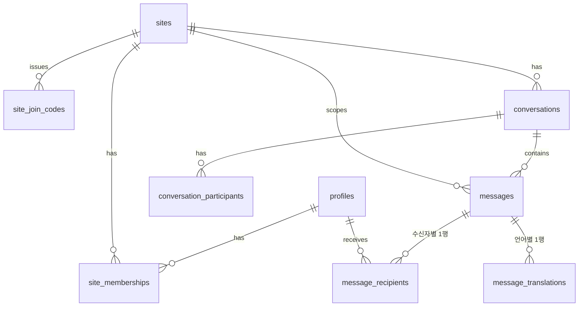

# 데이터베이스 설계

- DB: 로컬 Postgres (`embedded-postgres`로 실행). ORM: Prisma 7 + `@prisma/adapter-pg`.
- 클라이언트는 DB에 직접 접근하지 않고 API 서버만 사용한다. Supabase는 인증에만 쓰고 데이터는 저장하지 않는다.
- 사용자 id는 Supabase `auth.users.id`(uuid)를 그대로 쓰되, 다른 DB이므로 외래 키는 걸지 않는다.
- 공통 컬럼: `id uuid PK default gen_random_uuid()`, `created_at timestamptz default now()`, `updated_at timestamptz`.
- 부분 UNIQUE 인덱스와 CHECK 제약은 Prisma 마이그레이션 SQL에 직접 작성한다.

## 1. ER 개요



## 2. 테이블

### profiles
Supabase `auth.users`와 1:1. 최초 인증 요청 시 서버가 생성(upsert).

| 컬럼 | 타입 | 제약 |
|---|---|---|
| id | uuid | PK (= auth.users.id) |
| display_name | text | NOT NULL, 1–40자 |
| preferred_lang | text | NOT NULL, CHECK in ('ko','zh','vi','uz','ru') |
| auto_play | boolean | NOT NULL default true |
| speech_rate | real | NOT NULL default 1.0, CHECK 0.5–1.5 |
| deleted_at | timestamptz | NULL |

### sites
| 컬럼 | 타입 | 제약 |
|---|---|---|
| name | text | NOT NULL |
| address | text | NULL |
| created_by | uuid | FK profiles |
| status | text | CHECK in ('active','archived') default 'active' |

### site_memberships
| 컬럼 | 타입 | 제약 |
|---|---|---|
| site_id | uuid | FK sites |
| user_id | uuid | FK profiles |
| role | text | CHECK in ('manager','member') |
| status | text | CHECK in ('pending','active','rejected','removed') |
| lang_override | text | NULL. 관리자가 지정한 현장 내 언어 (없으면 preferred_lang) |
| decided_by | uuid | NULL, FK profiles |
| decided_at | timestamptz | NULL |

- UNIQUE(site_id, user_id). 재가입은 같은 행의 상태를 `pending`으로 되돌린다.
- INDEX(user_id, status), INDEX(site_id, status).
- 현장 생성 시 생성자의 `manager/active` 멤버십과 기본 그룹 대화를 **같은 트랜잭션**에서 만든다.

### site_join_codes
| 컬럼 | 타입 | 제약 |
|---|---|---|
| site_id | uuid | FK sites |
| code | text | UNIQUE. 8자리, 혼동 문자(0,O,1,I,L) 제외 |
| created_by | uuid | FK profiles |
| expires_at | timestamptz | NULL 허용 (만료 없음) |
| max_uses | int | NULL 허용 |
| use_count | int | default 0 |
| revoked_at | timestamptz | NULL |

### conversations
| 컬럼 | 타입 | 제약 |
|---|---|---|
| site_id | uuid | FK sites |
| type | text | CHECK in ('direct','group') |
| direct_key | text | NULL. direct일 때 `작은uuid:큰uuid` |
| title | text | NULL (group용) |
| last_message_at | timestamptz | NULL |

- 부분 UNIQUE(site_id, direct_key) WHERE type='direct' → 같은 두 사람의 1:1 대화는 현장당 1개.
- MVP의 group은 현장 기본 그룹 1개 (현장 생성 시 생성). 활성 멤버는 자동 참여.

### conversation_participants
| 컬럼 | 타입 | 제약 |
|---|---|---|
| conversation_id | uuid | FK |
| user_id | uuid | FK |
| left_at | timestamptz | NULL |

- PK(conversation_id, user_id). 멤버 제외 시 `left_at` 설정.

### messages
1:1, 그룹, 일괄 지시를 모두 담는다.

| 컬럼 | 타입 | 제약 |
|---|---|---|
| site_id | uuid | FK sites, NOT NULL |
| conversation_id | uuid | NULL (instruction이면 NULL) |
| kind | text | CHECK in ('direct','group','instruction') |
| sender_id | uuid | FK profiles |
| client_message_id | text | NOT NULL |
| seq | bigint | identity. 정렬 기준 |
| input_type | text | CHECK in ('text','audio') |
| source_lang | text | 발신 시점 발신자 언어 |
| raw_text | text | NULL. 입력 텍스트 또는 STT 결과 |
| corrected_text | text | NULL. 현장 특화 보정 결과 |
| glossary_hits | jsonb | default '[]' |
| requires_ack | boolean | default false (instruction에서 사용) |
| status | text | CHECK in ('queued','processing','done','partially_failed','failed') |
| error_code | text | NULL |

- UNIQUE(sender_id, client_message_id) → 중복 전송 방지.
- INDEX(conversation_id, seq), INDEX(site_id, kind, created_at).
- CHECK: kind='instruction' ↔ conversation_id IS NULL.

### message_translations
대상 언어별 번역 결과 1행. 같은 언어 수신자는 이 행을 공유한다.

| 컬럼 | 타입 | 제약 |
|---|---|---|
| message_id | uuid | FK messages |
| target_lang | text | |
| status | text | CHECK in ('pending','processing','done','failed','skipped') |
| translated_text | text | NULL (skipped면 원문 사용) |
| audio_path | text | NULL. 서버 로컬 음성 파일 경로 (`storage/audio/...`) |
| model | text | NULL |
| attempts | int | default 0 |
| latency_ms | int | NULL. 단계별 시간은 `timings jsonb`로 |
| timings | jsonb | NULL |
| error_code | text | NULL |

- UNIQUE(message_id, target_lang).
- `skipped`: 원어와 대상 언어가 같을 때.

### message_recipients
수신자별 전달 상태 1행.

| 컬럼 | 타입 | 제약 |
|---|---|---|
| message_id | uuid | FK |
| user_id | uuid | FK |
| target_lang | text | 발신 시점의 수신자 언어 (스냅샷) |
| status | text | CHECK in ('pending','sent','delivered','acknowledged','completed','failed') |
| sent_at / delivered_at / acknowledged_at / completed_at | timestamptz | NULL |
| response_note | text | NULL (완료 응답 메모) |

- PK(message_id, user_id). INDEX(user_id, status), INDEX(user_id, updated_at).

### openai_usage (Phase 1 구현 완료)
OpenAI 호출 1건의 사용량과 추정 비용. 비용 한도의 기준 데이터.

| 컬럼 | 타입 | 제약 |
|---|---|---|
| kind | text | CHECK in ('stt','translate') |
| model | text | NOT NULL |
| input_text_tokens / input_audio_tokens / cached_input_tokens / output_text_tokens / output_audio_tokens | int | default 0 |
| cost_usd | numeric(12,6) | CHECK >= 0 |
| created_at | timestamptz | INDEX |

## 3. 상태 모델

```
message_translations: pending → processing → done | failed(재시도 → processing) | skipped

message_recipients:   pending → sent → delivered → acknowledged → completed   (acknowledged/completed는 instruction만)
                      pending → failed  (해당 언어 번역 실패)  → 재시도 성공 시 sent

messages.status (집계값, 파이프라인 종료 시 갱신):
  queued → processing → done | partially_failed | failed
```

- **sent**: 서버가 이벤트를 발행함. **delivered**: 단말이 수신을 확인함. **acknowledged**: 사람이 "확인" 버튼을 누름. 세 상태를 구분한다.
- 지시 진행률은 `message_recipients`를 상태별로 집계해 계산한다(별도 카운터 없음).

## 4. 일관성과 복구

- 메시지 생성 시 `messages`, `message_translations`(대상 언어별), `message_recipients`(대상자별)를 **한 트랜잭션**으로 INSERT.
- 소켓 이벤트는 트랜잭션 커밋 후에 발행. 유실되면 클라이언트 동기화로 보정.
- 서버 시작 시 `processing` 상태로 2분 이상 멈춘 번역 행과 `pending` 행을 다시 큐에 넣는다.
- 동시 재시도 경쟁은 `UPDATE ... SET status='processing' WHERE id=$1 AND status IN ('pending','failed')` 조건부 갱신으로 방지.

## 5. 보존과 삭제

- 보존 기간·삭제 규칙은 `RetentionPolicy` 플러그인이 결정한다 (architecture.md 7절). 기본값은 삭제하지 않음.
- 현장 삭제 대신 `archived` 처리. 사용자 탈퇴 시 `profiles.deleted_at` 설정과 표시 이름 익명화.
