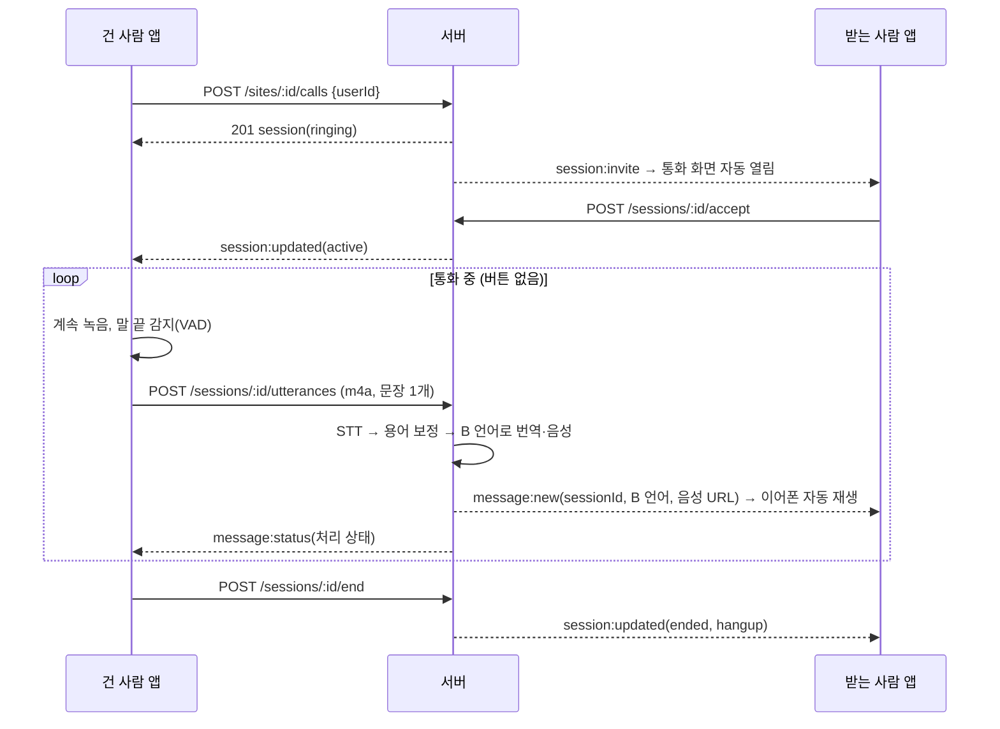
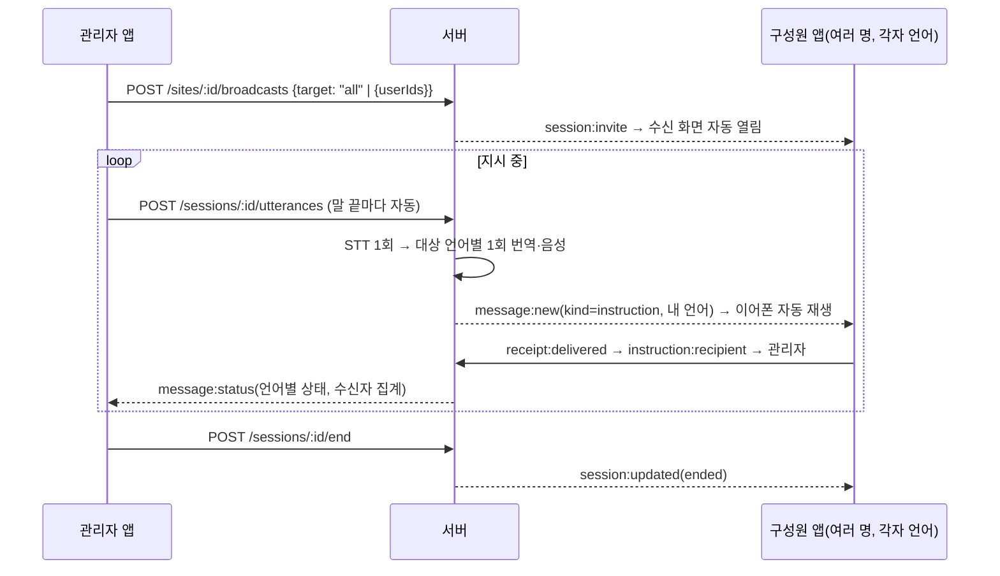

# 실시간 통역 (1:1 통역 통화 · 관리자 일괄 지시) — Phase 5

- 작성: 2026-10-12. Phase 5 범위를 "그룹 대화 + 일괄 지시"에서 이 작업으로 바꿈 (사용자 결정)
- 구현 방식: **핸즈프리 발화 단위 통역** (사용자 결정). 진짜 오디오 스트리밍은 아니다 (9절)
- 관련 문서: [api-specification.md](api-specification.md) 11절, [realtime-protocol.md](realtime-protocol.md) 9절, [database-design.md](database-design.md) `live_sessions`

## 1. 작업 전 상태 (코드 분석 결과)

| 항목 | 실제 동작 (Phase 4까지) |
|---|---|
| 화면 | 탭 4개(대화·지시·멤버·설정). 대화방에 **"누르고 말하기" 버튼**: 누르는 동안 녹음 → 떼면 m4a 파일 업로드 |
| 음성 처리 | 파일 업로드(`POST /conversations/:id/messages`, multipart) → 서버 파이프라인: 16kHz 변환 → 노이즈 필터 → STT → 현장 용어 보정 → 언어별 번역+음성(gpt-realtime-2.1) → WAV 저장 |
| 전달 | Socket.IO `message:new` → 앱이 **자동 재생**(설정의 자동 재생이 켜져 있을 때). 수동 재생은 '다시 듣기'용 |
| 실시간 통신 | Socket.IO는 알림용. **음성 스트리밍 없음**. 통화(연결·수락·종료) 개념 없음 |
| 이어폰 | "일반 블루투스 헤드셋으로 취급"만. 입력 장치 선택·연결 상태 확인 없음. Android 녹음 소스 `voice_recognition` |
| 일괄 지시 | 서버 API 없음(Phase 5 예정). 앱은 데모 데이터로 "글/음성 파일로 작성 → 확인·완료 응답" 문서형 |
| 대화 기록 | 1:1·그룹 대화 메시지(원문·번역·상태) 저장·조회 동작 |

결론: **음성 파일을 보내고 받는 무전기(PTT)식 구조**였다. 요구한 "통화처럼 말하면 상대 이어폰으로 통역" 흐름(연결 → 버튼 없이 말하기 → 자동 전달)과 관리자 실시간 일괄 지시는 없었다.

## 2. 기술 제약과 방식 결정

설치된 `expo-audio` 57의 네이티브 코드를 확인한 결과:

| 기능 | iOS | Android | 웹 |
|---|---|---|---|
| 파일 녹음 `AudioRecorder` + 음량 측정(metering) | ○ (playAndRecord + 블루투스 HFP 허용) | ○ (`setInput`으로 블루투스 SCO 마이크 선택) | ○ |
| 실시간 PCM 스트리밍 `AudioStream` | 녹음 전용 세션(`.record`)으로 고정 → **스트리밍 중 재생 불가, 블루투스 불가** | 휴대폰 마이크(MIC)만 | 미지원 |

진짜 스트리밍 통화(전이중)는 Swift/Kotlin 네이티브 오디오 모듈을 새로 만들어야 하고 실기기 없이는 검증할 수 없다. 그래서 사용자 승인 하에 다음 방식으로 구현했다.

**핸즈프리 발화 단위 방식**
- 통화가 연결된 동안 앱이 계속 녹음하며 0.1초마다 음량을 읽는다.
- 말이 끝나면(0.8초 침묵, VAD) 그 구간을 잘라 자동 전송하고 곧바로 다음 구간을 녹음한다. **버튼을 누르지 않는다.**
- 서버는 기존 통역 파이프라인으로 처리하고, 상대 앱은 받은 통역을 **설정과 무관하게 자동 재생**한다.
- 통역 음성이 재생되는 동안에는 듣기를 멈춘다(내 이어폰 소리가 마이크로 다시 들어가지 않게). 말하는 중이었다면 그 발화는 끝까지 보낸다.
- 지연: 말이 끝난 뒤 업로드 + STT + 번역·음성 생성 시간 (실제 OpenAI 측정 전, 추정 2–4초). 전송 계층(`useHandsFree` → `POST /sessions/:id/utterances`)을 분리해 두어 나중에 스트리밍으로 바꿀 수 있다.

## 3. 1:1 실시간 통역 통화

- 상태: `ringing`(울림) → `active`(통화 중) → `ended`. 종료 사유를 구분해 저장·표시: `hangup`(끊음) `declined`(거절) `missed`(30초 무응답) `cancelled`(건 사람이 취소) `connection_lost`(연결 끊김) `removed`(현장에서 제외)
- 조건: 상대가 현장 활성 멤버이고 **앱에 접속 중**이어야 한다(아니면 409). 이미 통화 중인 사람에게는 409 `BUSY`
- 연결 감시: 한쪽의 실시간 연결이 모두 끊기면 상대 화면에 "상대 연결이 끊겼어요"를 즉시 표시하고, 20초 안에 돌아오지 않으면 `connection_lost`로 종료. 돌아오면 그대로 계속. 내 연결이 끊기면 "다시 연결하는 중…"을 표시하고 듣기를 멈춘다
- 화면(`frontend/src/app/site/call/[id].tsx`): 울림(받기·거절 / 취소) → 통화 중(상대 이름·언어·헤드셋, 마이크 상태와 음량, 통역 내용, 마이크 끄기, 끊기) → 종료(사유, "대화 기록 보기")
- 시작 위치: 멤버 탭 → 멤버 → **통역 통화** / 1:1 대화방의 초록 통화 버튼

### 3-1. 음량 버튼으로 통화 상대 바꾸기 (계획, 2026-10-26 — 시행 승인 대기, 단계: [implementation-plan.md](implementation-plan.md) C1)

| 입력 (통화 중·내가 거는 중) | 동작 |
|---|---|
| 음량 증가 버튼 빠르게 두 번 (0.45초 안) | 지금 통화를 끊고 **다음** 멤버에게 건다 |
| 음량 감소 버튼 빠르게 두 번 | **이전** 멤버에게 건다 |
| 한 번만 누름 | 음량만 바뀐다 (두 번째를 기다리느라 약 0.45초 늦게) |

- **두 번 누르기는 음량을 바꾸지 않는다.** Android 휴대폰 버튼은 입력을 가로채 순간도 안 바뀌고, iOS·헤드셋 버튼은 바뀌자마자 되돌린다(아주 짧게 바뀌었다 돌아올 수 있음)

- 누구나: 관리자·구성원 모두. 걸려 온 전화가 울리는 동안에는 쓰지 않는다
- 순서: 현장의 모든 활성 멤버(나 제외)를 멤버 탭 순서로, **끝에서 다음은 처음, 처음에서 이전은 끝**(원형). 접속 안 했거나 다른 통화 중인 사람은 건너뛴다
- 바뀔 때 **새 상대의 이름을 음성으로** 알린다 ("○○ 님에게 전화합니다", 내 언어, 건 직후). 아무도 걸 수 없으면 "통화할 수 있는 멤버가 없어요" — 이때 지금 통화는 끊지 않는다
- 바꾸는 순서: 다음 사람 정하기 → 지금 통화 끊기 → 걸기(그 사이 다른 통화 중·접속 끊김이면 그다음 사람) → 새 통화 화면. 구현 `frontend/src/audio/useCallCycle.ts`
- 지켜보는 동안 음량은 1칸 ~ 최대-1칸 (끝에서는 그쪽 버튼을 알 수 없어서), 앱이 뒤로 가면 지켜보기를 멈춘다
- 넘어간 상대는 **받기를 눌러야** 연결된다
- 휴대폰 음량 버튼과 블루투스 헤드셋 음량 버튼 모두 대상 (헤드셋 버튼은 기기마다 실기기 확인)
- 함께 고침: **걸려 온 전화는 어느 화면에 있든 뜬다** (현장 목록·다른 현장 화면 포함). 지금은 그 현장 화면 안에 있을 때만 뜨고, 아니면 30초 뒤 부재중

## 4. 관리자 실시간 일괄 지시 (1:N)

- 권한: 관리자만 시작·발화·종료(구성원 403). 다른 현장 사람은 404
- 대상: `all` = 관리자를 뺀 현장 구성원(role member) 전체, 또는 선택한 활성 멤버. 현장 밖 사람을 넣으면 400
- 언어: 구성원마다 현장 언어(관리자가 지정한 언어 또는 본인 언어)로 받는다. 같은 언어 수신자는 번역 1회를 공유, 관리자와 같은 언어면 번역 없이 원문
- 연결이 끊긴 대상자: 관리자 화면에 '연결 끊김'으로 표시. 지시는 기록으로 남아 다시 접속하면 '받은 지시'에서 볼 수 있다. 관리자 연결이 20초 이상 끊기면 지시 종료
- 관리자 화면(`broadcast/new.tsx` → `broadcast/[id].tsx`): 대상 선택(전체·개별, 언어·연결·헤드셋 상태, 언어 분포) → 지시 중(구성원 연결 상태 a/b, 구성원별 헤드셋, 마이크 상태, 말한 지시별 언어 상태, 눌러서 구성원별 전달 상태) → 끝내기
- 구성원 화면: "{관리자} 님의 실시간 지시", 내 언어 번역문 + 관리자 원문, 이어폰 상태, 종료 안내
- 1:1 통화와 구분: 다른 화면·다른 상태(`mode`)·다른 기록(1:1 대화 vs 지시 목록), 동시에 각각 하나씩만 가능

## 5. 이어폰 오디오 입출력

- 오디오 세션: 통화·지시 중 `allowsRecording: true`(iOS playAndRecord + 블루투스 HFP), `interruptionMode: doNotMix`. 끝나면 녹음 모드 해제
- 녹음: 16kHz mono AAC 32kbps(30초 ≈ 120KB), 음량 측정 켬. Android 녹음 소스 `voice_communication`(기기의 에코 제거·자동 음량 사용, 블루투스 SCO와 함께 동작)
- 입력 장치: 녹음기 준비 후 입력 목록에서 블루투스(iOS `BluetoothHFP`, Android `BluetoothSCO`) → 유선 순으로 선택. 5초마다 다시 확인해 연결·해제를 반영 (`audio/audioDevice.ts`)
- 출력: 별도 선택 API가 없어, 블루투스 HFP/SCO 입력을 쓰면 통역 음성도 같은 헤드셋으로 나간다고 본다. 휴대폰 마이크·스피커로 확인되면 "이어폰이 연결되지 않았어요" 안내. 확인할 수 없으면(웹 등) 단정하지 않는다
- 장치 상태 공유: 앱 → `device:status`(경로·장치 이름·마이크 권한) → 서버 메모리 → 멤버 목록 `device`, 세션 참여자 `device`, `device:changed`. 연결이 끊기면 지운다. 재연결 시 앱이 다시 보낸다
- 구성원(듣기만): 마이크는 쓰지 않지만 입력 장치를 확인해야 헤드셋 연결을 알 수 있어 녹음기를 준비만 한다 (`useAudioRouteProbe`)
- 마이크 권한 거부: "마이크 권한이 필요해요. 기기 설정에서 허용한 뒤 다시 시도" + 다시 시도 버튼, 서버에 `micPermission: denied` 보고
- 화면 꺼짐 방지: 통화·지시 중 `expo-keep-awake` (휴대폰만)

**발화 감지(VAD, `audio/vad.ts`)**: 처음 0.5초로 주변 소음을 재고, 소음보다 12dB(−50 ~ −20dBFS 범위) 큰 소리가 0.15초 이상 이어지면 말 시작, 0.8초 조용하면 말 끝. 0.4초 미만은 버림, 25초가 넘으면 끊어서 보냄(서버 제한 30초), 15초 동안 말이 없으면 녹음을 새로 시작(파일 크기 제한). 소음이 갑자기 커져 25초 내내 이어지면 기준선을 그 수준으로 올린다.

## 6. 대화 기록 저장·조회

| 데이터 | 저장 위치 |
|---|---|
| 세션 | `live_sessions`(현장, 모드 call/broadcast, 상태, 시작자, 수락·종료 시각, 종료 사유, 종료한 사람) + `live_session_participants`(역할 caller/callee/speaker/listener, 참여·퇴장 시각) |
| 발화 | 기존 `messages`에 `session_id` 추가. 통화 발화 = 1:1 대화의 `direct` 메시지, 일괄 지시 발화 = `instruction` 메시지(`requires_ack=false`) |
| 원문·번역·상태 | 기존 그대로: 원문(STT)·보정문·용어(`messages`), 언어별 번역·음성·상태·오류(`message_translations`), 수신자별 언어·전달 상태·시각(`message_recipients`) |

- 기존 데이터 호환: `session_id`는 NULL 허용이라 기존 메시지는 "직접 입력한 메시지"로 그대로 조회된다. API 응답에 `sessionId: null`이 추가될 뿐 기존 필드는 그대로
- 조회
  - 1:1 대화방: 통화 전후의 글 메시지와 통화 발화가 한 기록에 시간순으로, 통화 발화에는 **'통화'** 표시
  - 지시 탭: 문자 지시와 실시간 지시 발화가 한 목록에, 실시간에는 **'실시간'** 표시. 확인 응답 대신 전달 수(a/b명 전달). 누르면 구성원별 상태·언어별 번역
  - 세션 단위: `GET /sites/:id/sessions?mode=call|broadcast`(세션 목록), `GET /sessions/:id/messages`(그 세션 발화만)
  - 실시간 화면(통화·지시 중)과 기록 화면(대화방·지시 탭)은 분리. 통화 종료 화면에서 "대화 기록 보기"로 이동
- 음성 원본: 재시도용으로 기존처럼 `storage/uploads`에 보관(텍스트 기록과 별개). 삭제는 보존 정책 플러그인 담당

## 7. 변경 파일

**서버**
| 파일 | 내용 |
|---|---|
| `prisma/schema.prisma`, `migrations/…_phase5_live_sessions` | `live_sessions`, `live_session_participants`, `messages.session_id` + CHECK |
| `src/sessions/liveSessions.ts` | 세션 서비스: 통화(울림·수락·거절·끊기·부재중), 일괄 지시, 발화 대상 판단, 연결 끊김 유예·복구, 제외 시 처리, 시작 시 남은 세션 정리 |
| `src/routes/v1/sessions.ts` | 세션 API (11절) |
| `src/routes/v1/instructions.ts` | 일괄 지시 작성(문자·음성)·목록·상세·받은 지시·확인·완료 (원래 Phase 5 범위) |
| `src/messaging/createMessage.ts` | 메시지 생성 공통화 (대화·통화 발화·지시) |
| `src/http/upload.ts` | 음성 업로드·전송 속도 제한 공통 (모든 전송 경로가 1분 30회 한도를 함께 씀) |
| `src/realtime/gateway.ts`, `presence.ts` | `device:status`, 세션·장치·지시 수신 이벤트, 연결 끊김/재연결 → 세션 |
| `src/shared/api.ts`, `realtime.ts` | `LiveSession`, `DeviceStatus`, `Member.device`, `MessageView.sessionId`, `InstructionSummary.sessionId`, `BUSY` |

**앱**
| 파일 | 내용 |
|---|---|
| `src/audio/vad.ts`, `useHandsFree.ts`, `audioDevice.ts`, `useAudioRouteProbe.ts` | 발화 감지, 핸즈프리 녹음·자동 전송, 헤드셋 선택·상태, 듣기 전용 장치 확인 |
| `src/app/site/call/[id].tsx` | 1:1 통역 통화 화면 |
| `src/app/site/broadcast/new.tsx`, `[id].tsx` | 일괄 지시 시작·관리자 콘솔·구성원 수신 화면 |
| `src/components/live/LiveParts.tsx` | 마이크 상태, 헤드셋 표시·안내, 진행 중 세션·연결 끊김 배너 |
| `src/providers/RealtimeBridge.tsx` | 통화 수신·지시 시작 시 화면 열기, 세션 발화 강제 자동 재생, 세션·장치 이벤트 반영 |
| `src/app/site/(tabs)/*`, `chat/[id].tsx`, `components/chat/*`, `InstructionCards.tsx` | 멤버 탭 통화 버튼·헤드셋 표시, 지시 탭 "실시간 지시 시작", 1:1 대화방 통화 버튼(누르고 말하기 대신), 통화/실시간 표시 |
| `src/app/site/instruction/new.tsx` | 문자 지시 전용(음성 파일 지시 제거 → 실시간 지시로) |
| `src/services/*` | 세션 API·장치 보고 (live: HTTP·Socket.IO / mock: 데모) |
| `src/i18n/strings.ts` | 실시간 통역 문구 5개 언어 (zh·vi·uz·ru 원어민 검수 필요) |

그룹 대화의 "누르고 말하기"는 유지했다 (그룹은 이번 실시간 범위 밖이고 대체 수단이 없음. 받는 쪽은 자동 재생).

## 8. 검증

### 자동 (코드 수준)
| 범위 | 결과 |
|---|---|
| 서버 테스트 (`cd server && npm test`) | **126개 통과** (이번 추가 20개: 세션 15, 지시·그룹 5) — 실제 Postgres + Socket.IO + Fake 엔진 |
| 변이 검증 | 구성원 발화 차단·연결 끊김 종료 코드를 빼면 해당 테스트 3개 실패 확인 후 복구 |
| 앱 발화 감지 단위 테스트 (`npm run test:unit`) | 11개 통과 (조용한 곳·소음 -35dB·충격음·짧은 발화·쉼·25초 분할·무발화·소음 급증 등) |
| 앱 타입 검사·expo-doctor | 통과, 21/21 |
| 웹 빌드 + 헤드리스 Chrome (데모 모드, `npm run e2e`) | **50개 통과**, 콘솔 오류 0 (이번 추가 28개: 흐름 7·8·9) |

| 시나리오 | 자동 검증 | 실제 환경 |
|---|---|---|
| A. 1:1 통화 연결 → 서로 말하면 상대에게 통역 | 서버: 울림·수락·양방향 발화(실제 m4a)·자동 수신·종료. 앱(웹 데모): 통화 걸기 → 통화 중 → 상대 통역 응답 → 끊기 → 기록 | 실기기·이어폰 미검증 |
| B. 선택 구성원에게만 각자 언어로 | 서버: 선택 대상만 수신(대조군 포함). 앱: 대상 선택 → 지시 → 언어별 통역문 | 미검증 |
| C. 전체 대상 → 연결된 전원에게 | 서버: 4명 전원 수신, 언어별 1회 번역 | 미검증 |
| D. 언어가 다르면 각자 언어로 | 서버: vi·zh·ru·vi → 각자 언어. 앱: 구성원(우즈베크어) 수신 화면 | 미검증 |
| E. 이어폰·네트워크 끊김 표시와 복구 | 서버: 통화 상대 끊김 → 오프라인 표시 → 유예 후 종료 / 유예 내 재연결 시 유지(대조군) / 지시 수신자 끊김 표시 / 관리자 끊김 → 종료 / 헤드셋 상태 보고·표시·연결 끊김 시 삭제. 앱: 마이크 권한 거부 안내, 헤드셋 상태 표시 | 블루투스 연결·해제 실제 동작 미검증 |
| F. 통화·지시 기록 구분 저장·조회 | 서버: 대화 기록에 통화 발화 표시, 지시 목록에 실시간/문자 구분, 모드별 세션 목록, 세션별 발화. 앱: 대화 기록 '통화' 표시, 지시 기록 '실시간' 표시 | — |
| G. 권한 없는 사용자 차단 | 서버: 구성원 시작 403·발화 403·종료 403, 다른 현장 404, 현장 밖 대상 400, 제외 시 세션에서 빠짐 | — |

### Android 에뮬레이터 · iOS 시뮬레이터 (2026-10-12, 사용자 요청으로 중간에 중단 → 나머지는 추후 확인)

| 항목 | 결과 |
|---|---|
| Android 개발 빌드 (`expo-keep-awake` 추가 후 재빌드, JDK 21) | 성공 (약 20분), 설치·실행 |
| 통화 화면에서 네이티브 녹음기 동작 | **확인**: 마이크 권한 허용 후 "듣고 있어요 — 말씀하세요" 상태로 동작, 앱 강제 종료(FATAL) 없음 |
| 장치 판별 | 에뮬레이터는 블루투스가 없어 "이어폰이 연결되지 않았어요" 안내 표시 (의도대로). 상대 헤드셋 칩(데모 데이터) 표시 |
| 데모 발화 → 상대 통역 응답, '통화' 표시 | 확인 |
| 마이크 끄기·켜기, 끊기 → 대화 기록, 일괄 지시 콘솔 | 스크린샷까지 진행됨 (결과 정리 전 중단) |
| **실제 말소리로 자동 전송(VAD)** | **미확인** — 에뮬레이터 호스트 마이크로 음성을 넣어 봤으나 음량 막대가 비어 있어 소리가 들어오지 않은 것으로 보임 |
| iOS 시뮬레이터 | 빌드 성공(영문 경로 복사본). 실행 화면 확인 전 중단 |
| 로그 | `W ReactNativeJS: Error: undefined` 1회 — 원인 미확인, 다음에 재현·조사 |

- 중단 사유: 사용자 요청(추후 확인). 작업 중 **디스크가 가득 참**(iOS 빌드용 복사본 5GB 삭제 후 여유 약 9GB). Android·iOS 빌드는 여유 공간을 넉넉히 확보한 뒤 할 것.
- 다시 할 때: `docs/phase4-report.md` 7절의 빌드 명령 → 멤버 탭 → 통역 통화 → 실제 말소리 감지(실기기 권장) → 일괄 지시 → 구성원 수신.
- **2026-10-12 이어서 확인 (Phase 6, `docs/phase6-report.md` 4절)**: 에뮬레이터에서 일괄 지시(시작·언어별 통역·종료)·구성원 수신(자동 열림·종료 표시)·통화(마이크 끄기·켜기·끊기·기록) 모두 확인, JS 오류 0건, `Error: undefined` 재현 안 됨. 실제 말소리 자동 전송은 웹 빌드 + Chrome 가짜 마이크(음성 파일)로 확인(`npm run e2e:mic`, 무음 대조군 포함).

## 9. 아직 안 된 것 · 실제 환경 검증 필요

- **실기기 + 블루투스 헤드셋**: 헤드셋 마이크 선택(SCO/HFP), 통역 음성이 헤드셋으로 나가는지, 연결·해제 감지, 에코 — 에뮬레이터·시뮬레이터로는 확인 불가
- **실제 OpenAI 호출**: 엔진 단독 왕복은 2026-10-12 확인(STT 0.9–1.9초, 음성 번역 약 3초, 말 끝 → 상대 약 5–6초 예상, 우즈베크어 품질 낮음). 서버 경로 실제 측정: 업로드 → 상대 수신 5.1초 (말 끝 기준 약 6초)
- ~~**실제 Supabase 계정**으로 앱 live 모드 ↔ 서버 통화·지시~~ — 2026-10-12 웹 빌드로 확인 (live e2e 27개, 양쪽 실제 녹음 자동 전송 포함). 네이티브 앱 live 모드는 실기기 때
- **동시에 말하기(전이중)**: 이 방식은 통역 재생 중 듣기를 멈추므로 동시 발화는 지원하지 않는다
- **앱이 백그라운드로 가거나 화면이 꺼지면** 녹음·재생이 멈출 수 있다 (화면 꺼짐 방지만 적용, 백그라운드 녹음 미적용). 다른 화면으로 나가면 듣기를 멈추고, 상단 배너로 돌아올 수 있다
- 녹음 구간을 자르고 다시 시작하는 사이(약 0.1–0.3초 추정)에 말한 앞부분이 잘릴 수 있다
- VAD 기준값(12dB, 0.8초 등)은 실제 현장 소음에서 조정이 필요하다
- 두 사람이 거의 동시에 서로에게 통화를 걸면 둘 다 울릴 수 있다 (통화 중 확인이 트랜잭션 밖, MVP 허용)
- 서버 재시작 시 열린 세션 정리(`closeStale`)는 코드만 있고 자동 테스트 없음 (테스트 DB를 여러 테스트 파일이 같이 써서 전체 정리를 테스트하면 다른 테스트를 깨뜨림)
- 세션·장치 상태·타이머는 서버 1대 메모리 기준

## 10. 추후 개선

1. **진짜 스트리밍** (상세 계획: [streaming-plan.md](streaming-plan.md), 2026-10-12 승인 — 1:1 통화만, 일괄 지시는 이 문서의 발화 단위 방식 유지): 네이티브 오디오 모듈(iOS playAndRecord+voiceChat+HFP, Android VOICE_COMMUNICATION+SCO, PCM 스트리밍 재생) + 서버 OpenAI Realtime 세션 유지(서버 VAD, 부분 결과 스트리밍). 지연 약 1–2초 기대, 대신 통화 시간 전체에 음성 입력 요금 (비용 한도 재검토 필요)
2. 백그라운드 통화 유지 (iOS 백그라운드 오디오, Android 포그라운드 서비스)
3. 실제 현장 소음 데이터로 VAD 기준 조정, 노이즈 필터 플러그인과 연동
4. 통화 중 상대 통역 재생 상태를 보내 "상대가 듣는 중" 표시
5. 지시 세션 요약 화면(세션별 발화·전달률 한눈에)
